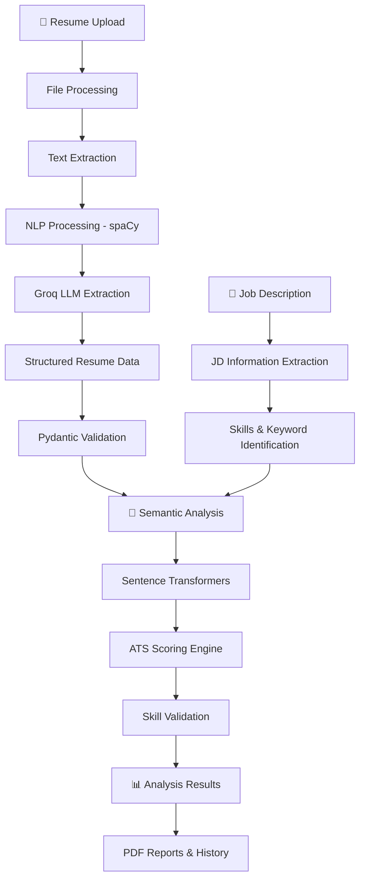

<div align="center">

# 🚀 ATS RESUME ANALYZER

### 🧠 AI-Powered Resume Intelligence & Job Compatibility Analysis

**📄 Analyze   |   🛡️ Validate   |   🎯 Match   |   📊 Optimize**

An intelligent Applicant Tracking System combining Machine Learning, NLP, Fine-Tuned Sentence Transformers and Generative AI to analyze resumes, evaluate job compatibility and deliver meaningful career insights.

<br/>


<br/><br/>

⭐ **AI • NLP • Machine Learning • Generative AI**

</div>

---

## 📌 Overview

**ATS Resume Analyzer** is an AI-powered resume evaluation platform designed to analyze candidate profiles and assess their compatibility with Applicant Tracking System (ATS) requirements.

It combines traditional NLP techniques, semantic similarity, structured data validation and Generative AI to provide comprehensive resume analysis.

The system evaluates resume content, formatting, keywords, skills and job-description compatibility while providing actionable insights to help candidates understand and improve their resumes.

---

## ✨ Key Features

### 📄 1. Intelligent Resume Parsing

* Extracts structured information from resumes.
* Identifies candidate details, skills, education and experience.
* Extracts projects, certifications and professional information.
* Uses Groq-powered LLM processing for structured information extraction.

### 🧠 2. NLP & Semantic Understanding

* Uses spaCy for natural language processing.
* Employs Sentence Transformers for semantic embeddings.
* Understands contextual similarity beyond exact keyword matching.
* Analyzes resume content against job requirements.

### 🎯 3. AI-Powered ATS Scoring

Evaluates resumes across five weighted dimensions:

| Evaluation Component |   Weight |
| :------------------- | -------: |
| 📄 Formatting        |      20% |
| 🔑 Keywords & Skills |      25% |
| ✍️ Content Quality   |      25% |
| 🧩 Skill Validation  |      15% |
| ⚙️ ATS Compatibility |      15% |
| **Total**            | **100%** |

### 🔍 4. Job Description Matching

* Extracts required and preferred skills.
* Identifies important job-related keywords.
* Performs keyword-based matching.
* Uses semantic similarity for contextual comparison.
* Highlights matched and missing keywords.
* Identifies skill gaps.

### ✅ 5. Skill Validation

* Identifies skills mentioned in a resume.
* Checks for supporting evidence in projects and experience.
* Separates validated and unvalidated skills.
* Provides skill validation insights.

### 🤖 6. Generative AI Integration

* Uses Groq API for structured information extraction.
* Processes resumes and job descriptions.
* Generates structured JSON outputs.
* Extracts important candidate and job information.

### 🛡️ 7. Pydantic-Based Data Validation

* Uses structured Pydantic schemas.
* Validates API response data.
* Maintains consistent response structures.
* Organizes analysis results into typed models.
* Supports reliable data exchange between application components.

### 📊 8. Detailed Analysis Reports

* Overall ATS score.
* Component-wise scoring breakdown.
* Skill validation insights.
* Job-description compatibility.
* Missing keyword identification.
* Resume improvement recommendations.
* PDF report generation.

### 🔐 9. Authentication & Analysis History

* Supabase-powered authentication.
* Google OAuth integration.
* User-specific analysis history.
* Access to previous analysis records.

---

## 🏗️ System Architecture

The application follows a modular architecture with separate frontend, backend, NLP and machine-learning components.

### 🔄 Resume Analysis Workflow



---

## 📊 ATS Scoring Methodology

The analyzer uses a weighted scoring approach to evaluate different aspects of a resume.

| Component            | Evaluation                                           |
| :------------------- | :--------------------------------------------------- |
| 📄 Formatting        | Resume structure and formatting                      |
| 🔑 Keywords & Skills | Relevant skills and keyword alignment                |
| ✍️ Content Quality   | Content strength and achievement-related information |
| 🧩 Skill Validation  | Evidence supporting listed skills                    |
| ⚙️ ATS Compatibility | Compatibility with ATS processing requirements       |

---

## 🛠️ Technology Stack

| Technology               | Purpose                               |
| :----------------------- | :------------------------------------ |
| 🐍 Python                | Core programming                      |
| ⚡ FastAPI                | Backend API framework                 |
| 🎨 Streamlit             | Interactive frontend                  |
| 🧠 Sentence Transformers | Semantic embeddings                   |
| 🔬 spaCy                 | Natural language processing           |
| 🤖 Groq API              | Generative AI integration             |
| 🛡️ Pydantic             | Data validation and schemas           |
| 🔥 PyTorch               | Deep learning framework               |
| 🔐 Supabase              | Authentication and data storage       |
| 📓 Jupyter Notebook      | Model experimentation and fine-tuning |
| 📊 NumPy / Pandas        | Numerical and data processing         |

---

## 📂 Project Structure

```text
ATS-RESUME-ANALYZER/
│
├── 📁 Jupyter_Notebooks_ats/
│   └── Model experimentation and fine-tuning
│
├── 📁 backend/
│   └── Backend API and processing logic
│
├── 📁 frontend/
│   └── Streamlit application and UI components
│
├── 📁 my_ats_model/
│   └── Fine-tuned model resources
│
├── 📄 requirements.txt
├── 📄 .gitignore
└── 📄 README.md
```

---

## ⚙️ Installation & Setup

### 1️⃣ Clone the Repository

```bash
git clone https://github.com/Yash4774/ATS-RESUME-ANALYZER.git
```

```bash
cd ATS-RESUME-ANALYZER
```

### 2️⃣ Create a Virtual Environment

```bash
python -m venv venv
```

**Windows:**

```powershell
venv\Scripts\activate
```

**Linux / macOS:**

```bash
source venv/bin/activate
```

### 3️⃣ Install Dependencies

```bash
python -m pip install --upgrade pip
pip install -r requirements.txt
```

### 4️⃣ Configure Environment Variables

Create a `.env` file and configure the required credentials.

```env
GROQ_API_KEY=your_groq_api_key

SUPABASE_URL=your_supabase_url
SUPABASE_KEY=your_supabase_key
```

Configure Google OAuth credentials separately through the appropriate Streamlit secrets configuration.

🔒 **Security:** Never upload API keys, OAuth secrets or private configuration files to GitHub.

---

## 🔬 Machine Learning & NLP

The project combines multiple approaches to understand resume content and job requirements.

**🧠 Sentence Transformers**

* Semantic representation of resumes and job descriptions.
* Contextual similarity analysis.
* Resume-to-job compatibility assessment.

**🔬 spaCy**

* Text processing.
* Linguistic analysis.
* NLP-based information extraction.

**🤖 Groq LLM**

* Structured resume information extraction.
* Job-description parsing.
* JSON-based information processing.

**🛡️ Pydantic**

* Typed data models.
* Structured API responses.
* Data validation.

---

## 🎯 Project Objectives

* Automate resume evaluation.
* Improve resume and job-description matching.
* Combine NLP with transformer-based semantic analysis.
* Validate candidate skills using supporting resume evidence.
* Provide interpretable ATS scoring.
* Generate actionable resume improvement insights.
* Build an AI-powered recruitment analysis platform.

---

## 👨‍💻 Author

<div align="center">

### Sahil Srivastava

<a href="https://github.com/Yash4774">

</a>

<br/><br/>

⭐ **If you find this project interesting, consider giving the repository a star!**

**Built with ❤️ using Python, NLP, Machine Learning & Generative AI.**

</div>
